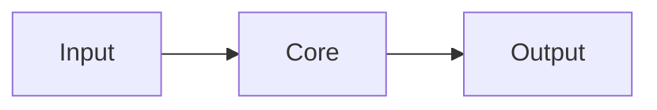

# Architecture

How {{PROJECT_NAME}} is built, for a person who will change it.

## The parts

| Part | What it does | May depend on | Licence |
| --- | --- | --- | --- |
| core | ... | nothing else of the project | ... |
| ui | ... | core | ... |

## The boundaries

State each rule an agent must keep, as a sentence it can check:

1. Only `ui` talks to the interface toolkit.
2. Libraries meant for reuse depend on no other part of the project.
3. Every change to user data goes through one place, and can be undone.

A change that needs to break a boundary is a decision for the owner.

## How data flows

## Extensions to standards

Where the project extends a standard (a file format, a protocol, a
component library), each extension is listed here or in a page of its own,
with its definition and its fallback, in the same change that adds it.
